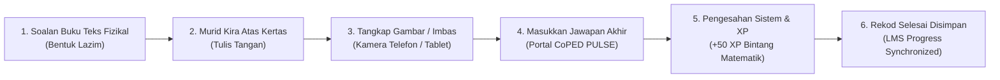

# CADANGAN TEKNIKAL & PEDAGOGI: PENILAIAN HIBRID & IMBASAN KERTAS KERJA (HYBRID PAPER-SCAN WORKSHEET ASSESSMENT)

```
==================================================================================================
DOKUMEN           : Kertas Cadangan Penilaian Hibrid KSSR & Imbasan Kertas Kerja Murid
SISTEM            : CoPED PULSE (Platform for Ubiquitous Learning & Skills Enhancement)
FAKULTI/JABATAN   : School of Computing, College of Arts and Sciences
                    Universiti Utara Malaysia (UUM), Sintok, Kedah
PENULIS           : Ahmad Abbas Bin Abu Dzarr (Software Engineering)
PENYELIA AKADEMIK : En. Mohd. Rushdi Idrus & Dr. Muhammad Syafiq bin Mohd Pozi
TARIKH            : November 2026
STATUS            : Untuk Perbincangan & Pengesahan Penyelia (Phase 1.5 Architecture)
==================================================================================================
```

---

## 1. Pengenalan & Latar Belakang Masalah (Executive Summary)

Dalam modul pembelajaran sekolah rendah (KSSR Semakan Kementerian Pendidikan Malaysia), pembelajaran Matematik Tahap 1 (Tahun 1, 2, dan 3) **tidak boleh dinilai secara kuiz aneka pilihan (multiple-choice) semata-mata**. 

### Mengapa Kaedah Kuiz Digital Semata-mata Tidak Memadai?
1. **Keperluan Pengiraan Bentuk Lazim**: Murid wajib membina kemahiran motor halus dan logik pengiraan langkah-demi-langkah di atas kertas—seperti mengumpul semula Puluh & Sa (regrouping/borrowing), menyusun nilai tempat, dan menulis titik perpuluhan wang (RM & sen).
2. **Isu Tebakan (Guessing) & Kalkulator**: Kuiz aneka pilihan digital memudahkan murid meneka jawapan `(A, B, C, D)` tanpa benar-benar membuat jalan kerja di atas kertas.
3. **Jurang Pembelajaran Hibrid**: Pembelajaran atas talian (LMS) sering terputus hubungan dengan buku latihan fizikal murid di bilik darjah.

Oleh itu, ciri **Penilaian Hibrid: Tugasan Kertas & Imbasan** direka untuk menggabungkan **kertas kerja fizikal murid** dengan **sistem pengesahan digital & gamifikasi CoPED PULSE**.

---

## 2. Konsep & Aliran Kerja Penilaian Hibrid (The 2-Factor Workflow)



### Soalan Berfokus Mengikut Sukatan KSSR:
- **Tahun 1 (Jilid 1)**: Tambah & tolak bentuk lazim (kumpul semula Puluh dan Sa):  
  *Contoh*: $39 + 47 = \underline{\hspace{1cm}}$ dan $63 - 7 = \underline{\hspace{1cm}}$
- **Tahun 2 (Jilid 2)**: Pengiraan baki wang tolak berturut-turut:  
  *Contoh*: $\text{RM}90.00 - \text{RM}54.60 - \text{RM}27.00 = \underline{\hspace{1cm}}$
- **Tahun 3 (Jilid 2)**: Pertukaran unit metrik dan operasi darab panjang:  
  *Contoh*: $6 \times 6\text{ m } 80\text{ cm} = \underline{\hspace{1cm}}\text{ m }\underline{\hspace{1cm}}\text{ cm}$

---

## 3. Status Pelaksanaan Semasa (Phase 1: Proof-of-Concept)

Ciri ini telah dibangunkan dalam portal murid di fail [`Learner/Course/Learn.jsx`](file:///home/abbas/coped_pulse/CoPED-PULSE/coped-pulse/resources/js/Pages/design_v1/Learner/Course/Learn.jsx) di bawah **Langkah 4: Latihan Kertas & Kuiz**.

### Perkara Yang Telah Berfungsi (Working Features):
- **Pengesanan Mod Sekolah Automatik**: Mengaktifkan tab hibrid hanya pada subjek bercirikan sekolah (`course_mode = 'school'`).
- **Pratonton Gambar Segera**: Menggunakan input kamera peranti (`capture="environment"`) dengan pratonton resolusi tinggi bagi format JPG, PNG, atau PDF.
- **Butang Demo Rasmi**: `⚡ Gunakan Contoh Imbasan Kertas Murid (Demo)` yang menjana lukisan SVG bergaris merah/biru menunjukkan contoh kertas tulisan tangan murid sebenar.
- **Validasi Nilai Akhir & Gamifikasi**: Menyemak jawapan akhir murid, menganugerahkan **+50 XP Bintang Matematik**, dan mengemas kini peratusan tamat subtopik dalam pangkalan data.

---

## 4. Analisis Isu: Bolehkah Murid Menghantar Semula Kertas? (Resubmission Dilemma)

Berdasarkan perbincangan reka bentuk, timbul persoalan integriti akademik:
> *"Patutkah murid dibenarkan menghantar semula (resubmit/replace) imbasan kertas setelah status bertukar kepada Disahkan?"*

| Pilihan | Kelebihan | Kelemahan / Risiko |
|---|---|---|
| **Boleh Hantar Semula (Allow Resubmit)** | • **Peluang Memperbaiki Kualiti**: Jika gambar awal kabur, gelap, senget, atau tulisan sukar dibaca guru, murid boleh mengambil gambar baharu yang lebih jelas.<br/>• **Mesra Murid Rendah**: Murid Tahun 1-3 sedang belajar menggunakan kamera telefon pintar. | • **Risiko Ketidakjujuran**: Murid mungkin menghantar kertas kawan kemudiannya setelah melihat contoh jawapan. |
| **Tidak Boleh Hantar Semula (Strict Lock)** | • **Mencegah Penipuan**: Sekali dihantar dan disahkan, rekod terkunci rapi.<br/>• **Audit Integriti**: Memastikan murid tidak menukar fail selepas mendapat markah. | • **Kaku**: Jika gambar pertama rosak/tidak terbaca, guru tidak dapat menyemak jalan kerja sebenar murid tanpa reset manual oleh pentadbir. |

### Cadangan Penyelesaian Seimbang (The Balanced Recommendation):
1. **Had Percubaan Semakan (Maksimum 2 Percubaan)**: Murid dibenarkan `Hantar Semula Kertas` sekiranya gambar pertama kabur atau tidak memuaskan, tetapi sistem merekodkan nombor percubaan (*Attempt 1 of 2*).
2. **Kunci Kekal Selepas Pengesahan Guru**: Di masa hadapan (Phase 2), apabila guru telah menanda (*graded/verified*), butang hantar semula akan dikunci sepenuhnya.

---

## 5. Pelan Peningkatan Berperingkat (Roadmap Cadangan untuk Penyelia)

### Fasa 1.5 (Peningkatan Segera - Sedia Dilaksanakan):
- **Penyimpanan Keadaan Tempatan (LocalStorage Persistence)**:
  - Menyimpan status imbasan, nama fail, dan jawapan yang telah disahkan ke dalam `localStorage` pelayar murid.
  - Hasil: Apabila murid menyegarkan laman (*page reload*) atau berpindah ke bab seterusnya dan kembali semula, status tetap kekal **"✓ Disahkan Sistem (+50 XP)"** dan tidak hilang.
- **Butang Tukar/Baiki Imbasan**: Menambah butang `[ ↻ Kemas Kini Gambar Imbasan ]` sekiranya murid ingin menggantikan foto yang lebih terang sebelum keluar.

### Fasa 2 (Peningkatan Pangkalan Data & Portal Guru - Semester Hadapan):
- Membina jadual `worksheet_submissions` dalam pangkalan data PostgreSQL.
- Menyimpan fail foto kertas murid ke dalam storan pelayan (`storage/app/public/worksheets/`).
- Menambah tab **"Semakan Kertas Murid"** di dalam Studio Guru (`Staff/Courses/Edit.jsx`) supaya guru subjek boleh melihat gambar kertas kerja murid, memberi gred, dan menulis komen ringkas.

### Fasa 3 (AI Vision OCR Validation - Eksperimen Lanjutan):
- Mengintegrasikan Google Gemini 1.5 Flash Vision API untuk membaca jalan kerja tulisan tangan pada gambar secara automatik dan mengesan kesilapan konsep bentuk lazim (contoh: murid terlupa menolak nombor yang dipinjam).

---

## 6. Ringkasan Tindakan Untuk Pengesahan Penyelia

Dokumen ini mencadangkan agar:
1. **Fasa 1.5 (Penyimpanan LocalStorage & Butang Kemas Kini Imbasan)** dilaksanakan segera bagi memastikan pengalaman pengguna (UX) murid lancar dan tidak hilang apabila pelayar disegarkan.
2. Konsep Penilaian Hibrid ini dikekalkan sebagai nilai keunikan (*unique selling point*) CoPED PULSE berbanding sistem LMS konvensional yang lain.

