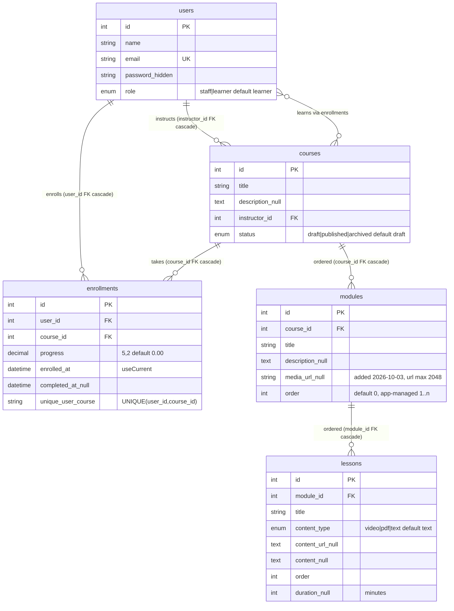
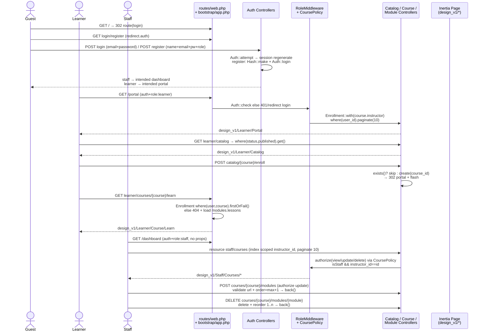

# CoPED PULSE — System Overview

> A lightweight Learning Management System (LMS) where instructors publish courses and learners enroll and work through modules. Sample data is themed around child-protection training, but the platform itself is general-purpose.
>
> **Status:** MVP, in active development. Canonical UI lives in `coped-pulse/resources/js/Pages/design_v1/` — legacy `Pages/` alongside it is unrouted dead code.
>
> Companion to [`README.md`](./README.md) (quickstart) and [`coped-pulse/`](./coped-pulse) (Laravel app). This document is the deep-dive: architecture, code, and product analysis.

**Table of Contents**

- [1. TL;DR](#1-tldr)
- [2. Tech Stack & Repository Map](#2-tech-stack--repository-map)
- [3. System Architecture (Architect lens)](#3-system-architecture-architect-lens)
- [4. Data Model](#4-data-model)
- [5. Request, Auth & Authorization Flow](#5-request-auth--authorization-flow)
- [6. User Journeys & Features (Product lens)](#6-user-journeys--features-product-lens)
- [7. Implementation Details (Developer lens)](#7-implementation-details-developer-lens)
- [8. Frontend Architecture](#8-frontend-architecture)
- [9. Scalability, Risks & Trade-offs](#9-scalability-risks--trade-offs)
- [10. Maintainability & Tech Debt](#10-maintainability--tech-debt)
- [11. Actionable Insights & Open Questions](#11-actionable-insights--open-questions)
- [Appendix A. Routes at a Glance](#appendix-a-routes-at-a-glance)
- [Appendix B. Demo Accounts & Commands](#appendix-b-demo-accounts--commands)

---

## 1. TL;DR

| Question | Answer |
|---|---|
| What | Monolithic server-driven SPA LMS: `staff` (instructor) creates `draft → published → archived` courses with ordered modules + optional `media_url`; `learner` browses catalog, enrolls (idempotent), views modules via external link |
| How | Laravel 13 + Inertia 3 returns `Inertia::render(component, props)`; React 19 swaps pages without client router; Ziggy exposes `route()` in JSX; Tailwind 4 + Vite 8 |
| Auth | Session cookie (`SESSION_DRIVER=database`), `RoleMiddleware (role:staff\|learner)` + `CoursePolicy` owner check (`instructor_id == id`) |
| Data | 5 models: `User –< Course –< Module –< Lesson`, `User –< Enrollment >– Course` with `unique[user_id,course_id]`, FK `cascadeOnDelete` |
| Gaps | Registration UI omits `role` (all signups 422); `Lesson` has schema but no routes/UI; no progress-write path; catalog `get()` unpaginated; no embedded video/search/unenroll; only `ExampleTest` coverage |

---

## 2. Tech Stack & Repository Map

| Layer | Technology | Evidence |
|---|---|---|
| Backend | Laravel 13.17, PHP 8.3+, Inertia-Laravel 3.5 | `coped-pulse/composer.json` |
| Auth | Session guard `web`, Sanctum 4 installed (only `GET /api/user` uses it) | `config/auth.php`, `routes/api.php` |
| Frontend | React 19.3 + `@inertiajs/react` 3.8, `ziggy-js` 2.6, `axios` | `coped-pulse/package.json` |
| Styling | Tailwind 4.3 (`@tailwindcss/vite`), Instrument Sans via Bunny | `resources/css/app.css`, `vite.config.js` |
| Build | Vite 8 + `laravel-vite-plugin`, inputs `css/app.css`, `js/app.jsx` | `vite.config.js` |
| DB | SQLite default (`database/database.sqlite`); MySQL/Redis/Meilisearch containers exist in `compose.yaml` but `.env` ignores them | `.env: DB_CONNECTION=sqlite, SESSION/CACHE/QUEUE=database` |

```
CoPED-PULSE/                          # git root, README.md, sail wrapper composer.json
└── coped-pulse/                      # <-- Laravel app (all analysis below relative to here)
    ├── app/
    │   ├── Http/Controllers/
    │   │   ├── Auth/AuthenticatedSessionController.php  # login/logout
    │   │   ├── Auth/RegisteredUserController.php        # register (requires role)
    │   │   ├── Learner/CatalogController.php            # index (published) + enroll
    │   │   └── Staff/CourseController.php               # 7 REST actions, scoped to instructor
    │   │   └── Staff/ModuleController.php               # store/update/destroy, order=max+1
    │   ├── Http/Middleware/RoleMiddleware.php           # alias `role`
    │   ├── Http/Middleware/RedirectIfAuthenticated.php  # alias `redirect.auth`
    │   ├── Http/Middleware/HandleInertiaRequests.php    # shares auth.user + ziggy
    │   ├── Models/User.php (isStaff/isLearner) Course.php Module.php Lesson.php Enrollment.php
    │   └── Policies/CoursePolicy.php + Providers/AuthServiceProvider.php
    ├── bootstrap/app.php             # slim bootstrap, middleware aliases, providers
    ├── routes/web.php (62 lines)     # all web logic; api.php + console.php are stock
    ├── database/
    │   ├── migrations/ (11 files: users, cache, jobs, tokens, courses, modules, lessons, enrollments, role, media_url)
    │   ├── factories/UserFactory.php CourseFactory.php EnrollmentFactory.php (no Module/Lesson factories)
    │   └── seeders/DatabaseSeeder.php CourseSeeder.php EnrollmentSeeder.php
    ├── resources/
    │   ├── views/app.blade.php (@routes + @vite + @inertia) / welcome.blade.php (dead)
    │   ├── css/app.css (@import 'tailwindcss')
    │   └── js/app.jsx + bootstrap.js + Layouts/design_v1/{StaffLayout,LearnerLayout}.jsx
    │       + Pages/design_v1/{Auth/Login,Register | Staff/Dashboard,Courses/Index,Create,Show,Edit
    │                         | Learner/Portal,Catalog,Course/Learn}.jsx (10 live files)
    │       + Pages/{Auth,Staff,Learner}/... (9 legacy files, unrouted — see §10)
    ├── config/ (stock), storage/ (local disk), tests/ (only ExampleTest), phpunit.xml
    └── composer.json package.json vite.config.js AGENTS.md CLAUDE.md
```

---

## 3. System Architecture (Architect lens)

**Pattern:** Classic Laravel MVC + Inertia server-driven SPA. No REST API consumed by React, no client router, no global store. The backend decides `component + props` on every response.

```mermaid
graph TB
    subgraph Client["Browser (React 19 SPA)"]
        A["app.jsx<br/>createInertiaApp<br/>resolve ./Pages/*.jsx"]
        Z["Ziggy route()<br/>+ axios"]
        L1["LearnerLayout<br/>indigo/purple"]
        L2["StaffLayout<br/>emerald/teal"]
    end

    subgraph Edge["HTTP Layer"]
        B["public/index.php"]
        MW["Web middleware<br/>session(database)<br/>CSRF + HandleInertiaRequests<br/>auth + role:staff/learner"]
    end

    subgraph App["Laravel 13 App"]
        R["routes/web.php<br/>14 routes"]
        AC["Auth Controllers<br/>login / register / logout"]
        SC["Staff Controllers<br/>CourseController + ModuleController<br/>+ CoursePolicy"]
        LC["Learner<br/>CatalogController + closures<br/>portal / learn"]
        M["Eloquent Models<br/>User Course Module Lesson Enrollment"]
    end

    subgraph Data["State (single node)"]
        DB[("SQLite file<br/>DB + sessions<br/>+ cache + queue")]
        FS["storage/app (local disk)"]
        LOG["mail=log<br/>broadcast=log"]
    end

    subgraph Build["Build"]
        V["Vite 8 + Tailwind 4<br/>npm run dev / build"]
    end

    A <-->|X-Inertia JSON on XHR<br/>full HTML via app.blade.php on first load| MW
    Z -->|route() helper| A
    B --> MW --> R
    R --> AC & SC & LC
    AC & SC & LC --> M --> DB
    App --> FS & LOG
    V -.->|hashed assets<br/>public/build| A
```

**Request lifecycle:**

```
Browser → public/index.php → bootstrap/app.php (web + HandleInertiaRequests)
 → session cookie (database table `sessions`) → auth → role:staff|learner (403 or redirect login)
 → Controller (validate → Eloquent → Inertia::render / redirect with flash)
 → HandleInertiaRequests::share(auth.user + ziggy.location)
 → app.blade.php (@vite) on full load, else Inertia JSON + client component swap
```

**Why this scales for MVP, strains later:**

- ✅ One deployable, no CORS/API versioning, session hardening (`regenerate/invalidate`), proper FK cascades.
- ⚠️ Everything stateful in one SQLite file + local disk (§9). `QUEUE=database` polls the same file. `compose.yaml` ships MySQL/Redis/Meilisearch/Selenium but app code ignores them — environment drift.
- ✅ Inertia `auth + ziggy` sharing avoids prop drilling; `paginate(10)` shape flows straight into React pagination links.

---

## 4. Data Model



**Relationships in code:**

- `User::courses() hasMany(Course, instructor_id)`, `enrollments() hasMany` — `app/Models/User.php:41-49`, `isStaff()/isLearner()` strict `===`.
- `Course::instructor() belongsTo`, `modules() hasMany→orderBy(order)`, `enrollments() hasMany`, `learners() belongsToMany via enrollments + pivot(progress,enrolled_at,completed_at)` — `Course.php:23-43`.
- `Module::course() belongsTo`, `lessons() hasMany→orderBy(order)`; `Lesson::module() belongsTo`; `Enrollment::user/course() belongsTo` with `decimal:2 + datetime` casts.
- **Orphaned:** `Lesson` has model + migration + eager-load (`CourseController@show`, `web.php:48`) but **no controller, routes, factory, seeder, or create UI** — staff `Show.jsx` lists lesson titles read-only; learner `Learn.jsx` ignores `lessons` entirely.
- **Write-path gap:** `progress/completed_at` are only set by factories/seeders (`inProgress/completed/notStarted` states); no route ever updates them — Portal/Learn badges read a value that can never change via UI.

---

## 5. Request, Auth & Authorization Flow



**Two RBAC mechanisms (both must pass):**

1. `RoleMiddleware` (`app/Http/Middleware/RoleMiddleware.php:13-31`, alias `role` in `bootstrap/app.php:23-26`): guest → 401 JSON or `redirect guest login`; `staff`≠`isStaff()` → `403 Staff access required` (same for learner). Single-string match, no multi-role.
2. `CoursePolicy` (`app/Policies/CoursePolicy.php`, registered in `AuthServiceProvider`): `viewAny/create = isStaff()`; `view/update/delete/restore/forceDelete = isStaff() && instructor_id==id`. Used in `CourseController@show/edit/update/destroy` and all `ModuleController` actions via `authorize('update', $course)`. No `ModulePolicy/EnrollmentPolicy/LessonPolicy`.

**Known authz holes (see §10–11):** `enroll` and `learn` never check `status==published` (draft/archived reachable by guessing ID); `ModuleController@update/destroy` authorize parent course but never verify `module.course_id == course.id` (no scoped bindings); `Register.jsx` never sends `role`.

---

## 6. User Journeys & Features (Product lens)

```mermaid
flowchart LR
    subgraph Guest["Guest"]
        ROOT["GET /"] --> LOGIN["GET/POST /login<br/>design_v1/Auth/Login"]
        LOGIN --> REG["GET /register<br/>design_v1/Auth/Register<br/>⚠️ missing role → 422"]
        REG -.->|broken| LOGIN
    end

    subgraph Learner["Learner (indigo/purple)"]
        P["GET /portal<br/>Portal.jsx<br/>ENROLLED/COMPLETED<br/>paginate 10"] --> C["GET learner/catalog<br/>Catalog.jsx<br/>all published, get()"]
        C -->|router.post enroll| E["POST catalog/{course}/enroll<br/>idempotent create<br/>→ 302 portal"]
        E --> P
        P -->|Continue Learning| LW["GET courses/{course}/learn<br/>Learn.jsx<br/>modules + View Media (_blank)<br/>firstOrFail gate"]
    end

    subgraph Staff["Staff / Instructor (emerald/teal)"]
        D["GET /dashboard<br/>Dashboard.jsx<br/>static cards, stats --"] --> I["GET staff/courses<br/>Index.jsx<br/>own courses table<br/>paginate 10"]
        I -->|New Course| NC["GET create + POST store<br/>Create.jsx<br/>title/desc/status"]
        NC --> I
        I -->|Title| SH["GET courses/{course}<br/>Show.jsx<br/>curriculum read-only"]
        SH -->|Edit| ED["GET edit + PUT update<br/>Edit.jsx<br/>course form +<br/>module add/delete"]
        ED -->|POST modules.store<br/>order=max+1| ED
        ED -->|DELETE modules.destroy<br/>+ reorder| ED
        I -->|Delete + confirm| I
    end

    LOGIN -->|learner@coped.org| P
    LOGIN -->|instructor@coped.org| D
```

### 6.1 Feature inventory (route → controller → page)

| # | Feature | Route | Backend | React page |
|---|---|---|---|---|
| L1 | Catalog (published only) | `GET /learner/catalog` (`learner.catalog`, `web.php:40`) | `CatalogController@index:12-22` `with(instructor)→where(published)→latest→get()` | `design_v1/Learner/Catalog.jsx` — cards + `router.post(enroll)` |
| L2 | One-click enroll (idempotent) | `POST /learner/catalog/{course}/enroll` (`web.php:41`) | `CatalogController@enroll:24-35` `exists()` check + `create(course_id)` | Same Catalog button; no confirm; flash never rendered (no toast) |
| L3 | Portal (enrolled list) | `GET /portal` (`web.php:28-37`) | Closure `Enrollment::with(course.instructor)→where(user)→paginate(10)` | `design_v1/Learner/Portal.jsx` — `COMPLETED/ENROLLED` via `completed_at`, `Continue Learning` |
| L4 | Learn view | `GET /learner/courses/{course}/learn` (`web.php:43-54`) | Closure `Enrollment→firstOrFail()` + `load(modules.lessons)` | `design_v1/Learner/Course/Learn.jsx` — `safeMediaUrl()` (http/https only) + `View Media target=_blank` |
| S1 | Dashboard hub | `GET /dashboard` (`web.php:24-26`) | Closure, **no props** | `design_v1/Staff/Dashboard.jsx` — Create/Manage cards + `Quick Stats --` placeholder |
| S2–S5 | Course CRUD + lifecycle | `resource staff/courses` (`web.php:58`) | `CourseController: index scoped instructor paginate; store/update validate title+status in:draft,published,archived; show/edit authorize + load modules` | `design_v1/Staff/Courses/Index,Create,Show,Edit.jsx` — table + status pills + forms + `router.delete + confirm()` |
| S6 | Module add/delete | `resource courses.modules only[store,update,destroy]` (`web.php:59-60`) | `ModuleController: validate title+description+media_url url|max:2048; store order=max+1; destroy reorder 1..n` | `Edit.jsx` bottom section; **`update` route exists but no edit UI**; no reorder UI |
| Auth | Login/register/logout, gating | `GET|POST login/register`, `POST logout`, `/→login` | `AuthenticatedSessionController` (`attempt + regenerate → dashboard\|portal`), `RegisteredUserController` (validates `role required`), `RedirectIfAuthenticated` bounces logged-in users | `design_v1/Auth/Login,Register.jsx` — glass cards, blobs, inline errors |

### 6.2 Usability: strengths vs. weaknesses

**Strengths:** persona theming (indigo/purple learner vs emerald/teal staff), sticky blurred nav with active pills, polished auth (labels, `processing` states, inline errors), designed empty states everywhere (Portal/Catalog/Learn/Index/Show/Edit), consistent pagination styling, `safeMediaUrl` XSS guard blocking `javascript:/data:`, `type=url` + backend `url` validation.

**Weaknesses (factual):** media is an external link — no `<video>/<iframe>` embed, learner leaves LMS; lessons invisible + unauthorable (schema without UI); no progress/completion write path (dashboard “track progress” copy is false); no search/filter/sort (catalog `get()` unbounded); no module-edit form; destructive `confirm()` dialogs; `success` flash never displayed; mobile nav `hidden md:flex` with no hamburger (mobile users stranded); registration 100% broken (`422 role required`); `enroll`/`learn` allow `draft/archived` via direct URL; generic placeholders (`Machine Learning`, `React`) off-theme.

### 6.3 Business alignment

Codebase is **general-purpose LMS** — zero child-protection domain logic (no safeguarding gating, certification, cohorts, quizzes, reporting). Theme lives only in `CourseSeeder.php:24-47` (5× Child Protection Fundamentals + 3× Psychosocial Support + 2× Case Management + 2× draft + 1× archived, all `forInstructor(staff)`) + app name + demo emails. Value today: “staff publish link lists; learners self-enroll and open links” — viable pilot/link-hub, not accountable training (no completion proof, analytics, or assessment). Note `count(5)→create([fixed title])` creates 5 identical-title rows per block — confusing demo content.

---

## 7. Implementation Details (Developer lens)

**Controllers (thin, inline validation, direct Eloquent — no FormRequests/Services/DTOs):**

- `Auth/AuthenticatedSessionController.php: create → design_v1/Auth/Login (canResetPassword:false unused); store validates email+password → Auth::attempt(remember) → regenerate → role redirect; destroy logout+invalidate+regenerateToken → /`.
- `Auth/RegisteredUserController.php:22-29` validates `name,email unique,password confirmed,role in:staff,learner` → `Hash::make` → `Auth::login` → role redirect. No throttle/verification/reset.
- `Learner/CatalogController.php:12-35` — `index get()` (no pagination); `enroll` app-level `exists()` + DB `unique(user_id,course_id)` but no status guard, no race `try/catch`.
- `Staff/CourseController.php:14-97` — `index where(instructor_id).paginate(10)`; `store/update` same rules; `show/edit` `authorize + load modules orderBy + lessons`; `destroy` cascades via FK.
- `Staff/ModuleController.php:12-58` — `store order=max+1`; `update $module→update`; `destroy delete + N-query reorder loop` (no transaction/lock, no reorder endpoint). No `index/show`.

**Middleware:** `RoleMiddleware`, `RedirectIfAuthenticated` (staff→dashboard else portal), `HandleInertiaRequests` (`rootView=app`, shares `auth.user + ziggy+location`). Slim `bootstrap/app.php` (no `Kernel.php`), `shouldRenderJsonWhen api/* or expectsJson`.

**Validation summary:** course `title required|max:255, description nullable, status in:draft,published,archived`; module `title required, description nullable, media_url nullable|url|max:2048`; register `role required|in:staff,learner` (unsatisfied by UI).

**Database:** 11 migrations in order `users → cache → jobs → tokens → courses → modules → lessons → enrollments → role → media_url`. Key DDL: `courses.status enum default draft`, `modules.media_url string nullable` (DB 255 vs validation 2048), `enrollments.progress decimal(5,2) default 0 + enrolled_at useCurrent + unique(user,course)`. Factories: `UserFactory` (no `role` — relies on DB default), `CourseFactory` (`published/draft/archived/forInstructor` states), `EnrollmentFactory` (`inProgress/completed/notStarted/forUser/forCourse`). Seeders: 3 users (`instructor@coped.org / learner@coped.org / test@example.com`, pw `password`) + 13 courses + first learner in first 3 published courses (one per progress state). Zero modules/lessons seeded — fresh DB shows empty curricula.

**Config versions:** `php ^8.3`, `laravel/framework ^13.17`, `inertiajs/inertia-laravel ^3.5`, `sanctum ^4.0`, `ziggy ^2.6`; `react ^19.3`, `@inertiajs/react ^3.8`, `vite ^8`, `tailwindcss ^4.3`, `axios ^1.20`, `phpunit ^12.5`. `phpunit.xml` uses sqlite `DB_DATABASE=testing`, suites `Unit + Feature`.

**Tests:** `tests/Feature/ExampleTest.php` (`/→302 login`, `login 200`, `register 200`) + `Unit/ExampleTest (assertTrue)` + stock `TestCase` — **~0% LMS coverage**: no auth flow, role matrix, CRUD/policy, ordering, enrollment uniqueness, catalog filter, `firstOrFail` gate.

---

## 8. Frontend Architecture

- **Entry:** `resources/js/app.jsx: createInertiaApp(title → ${title} - ${VITE_APP_NAME}, resolve ./Pages/${name}.jsx via import.meta.glob, progress #4B5563)`; `bootstrap.js` (axios + `X-Requested-With`); `views/app.blade.php` (`@routes + @vite + @inertia`); `css/app.css` (`@import 'tailwindcss' + Instrument Sans theme`).
- **Layouts:** `Layouts/design_v1/StaffLayout.jsx` vs `LearnerLayout.jsx` (59 lines each, identical structure, different gradients/links) — sticky glass nav, `max-w-7xl` slot. Legacy `Layouts/StaffLayout.jsx` unused.
- **Live pages (10, all routed):** `Auth/Login,Register` (109/127 lines, `useForm post(route())`), `Staff/Dashboard` (80, static), `Staff/Courses/Index` (123, `courses.data/links` table), `Create` (112, status select with helper), `Show` (106, read-only curriculum), `Edit` (223, course `PUT` + module `post preserveScroll reset` + `router.delete`), `Learner/Portal` (109, `enrollments.data` cards), `Catalog` (73, plain array cards), `Course/Learn` (117, `safeMediaUrl` + `_blank noopener`).
- **Conventions:** `useForm`, `router.post/delete`, `route()` (Ziggy), `usePage().url` active pills, Tailwind-only styling (no config, no kit, no TS, no i18n/dark-mode/error-boundaries/skeletons). `animate-blob/fade-in-up` classes referenced but undefined in `app.css` (dead).
- **No `Components/` directory** — duplication between `design_v1` and legacy instead of shared components.

---

## 9. Scalability, Risks & Trade-offs

| Concern | Current | Risk | Fix |
|---|---|---|---|
| DB | SQLite single file for DB + sessions + cache + queue | Write contention, no horizontal scale, `busy_timeout/journal_mode` untuned | Prod → MySQL (in `compose.yaml`) + Redis for session/cache/queue |
| Reads | `Catalog get()` unbounded; `portal/staff paginate(10)` no indexes beyond FKs; `learn` loads entire `modules.lessons` | Catalog OOM with 1k+ courses; curriculum blowup | Paginate catalog, add `where title like` search, add composite indexes, cap eager loads |
| Files | `FILESYSTEM_DISK=local`, media is external URLs only | No uploads/CDN/S3 path; disk not shared across replicas | Decide upload strategy (S3 + signed URLs) or stay link-only explicitly |
| Queue/mail | `QUEUE=database` on SQLite, `MAIL=log`, `BROADCAST=log` | No async emails/notifications possible | Wire SMTP/SES + real queue worker + scheduler when notifications needed |
| Security | Session regenerate good; `safeMediaUrl` good; but committed `.env` with `APP_KEY`, `DEBUG=true`, no rate-limit, no `active_url`/allowlist, staff `Edit.jsx` renders raw href | Secret leak, enumeration, stored-XSS drift | Rotate key, gitignore `.env`, add throttle, centralize sanitizer, custom 403/404 |
| Search | `SCOUT_DRIVER=database`, Meilisearch idle | No full-text | Either drop Scout or wire Meilisearch + `?q=` param |

---

## 10. Maintainability & Tech Debt

1. **`design_v1` vs legacy duplication (~70%):** 10 live + 9 dead pages (`Pages/Auth/*`, `Pages/Staff/*`, `Pages/Learner/*`) + `Layouts/StaffLayout.jsx` + `welcome.blade.php` + `api/user`. Legacy `Learner/Portal:46, Learn:33` reference `enrollment.status` (column doesn't exist — should be `progress/completed_at`). → Delete legacy or extract shared components.
2. **Registration broken:** `Register.jsx:4-9` omits `role`; `RegisteredUserController@store:28` requires it → 422 always. → Add role select or default `learner` server-side.
3. **Lesson dead model:** decide implement (`LessonController` + nested `courses.modules.lessons` routes + staff CRUD in `Edit.jsx` + render in `Learn.jsx`) or drop table/model to simplify to modules+`media_url`.
4. **Module scoping:** `ModuleController@update:30,destroy:45` never check `module.course_id==course.id` (`PUT /staff/courses/1/modules/99` where 99∈course 2 passes if user owns course 1). → `Route::resource(...)->scoped()` or `whereBelongsTo` + test.
5. **No module edit UI** despite `PUT` route; no `order` input/drag-drop; `destroy` N+1 reorder without `DB::transaction`. → Inline edit modal + transaction + up/down endpoint.
6. **Enrollment guards missing:** `enroll` allows `draft/archived` by direct POST; `learn` allows viewing archived if enrolled before unpublish. → `abort_if(status!=='published',404)` + unenroll `DELETE`.
7. **Media split:** backend `url|max:2048` vs learner `safeMediaUrl` vs staff raw `href` in `Edit.jsx:141`. → Centralize + consider `active_url`/allowlist.
8. **Lifecycle unenforced:** enum + select only; no transition rules (archived read-only?). → Policy/state machine if needed.
9. **Naming:** `CatalogController` handles enroll (should be `EnrollmentController`); `dashboard/portal/learn` closures in `web.php` vs controllers; `media_url vs content_url` dual naming.
10. **Factories/seeders:** `UserFactory` missing `role`; `CourseSeeder count(N)→create([fixed title])` duplicates titles.

---

## 11. Actionable Insights & Open Questions

### P0 — Broken / blocking

- [ ] **Fix registration role.** Options: (a) add `role` select to `Register.jsx` (default `learner`, `staff` behind invite code?), (b) default `learner` server-side and relax `role required`. *Q: Should self-registration create staff? Who approves instructors?*
- [ ] **Decide lessons vs modules.** Either render `module.lessons` in `Learn.jsx` + add `LessonController` + staff lesson CRUD, or drop `lessons` migration/model. *Q: Is a lesson (video/pdf/text + duration) the atomic learning unit, or is module+media_url enough?*
- [ ] **Guard enroll/learn by status.** `abort(404) if status!=='published'` in `CatalogController@enroll` + `learn` closure; handle “archived but enrolled” UX (read-only notice vs block). *Q: Should archived remain viewable to existing learners?*
- [ ] **Progress/completion MVP.** Add `POST learner/courses/{course}/complete` or per-module `Mark done` writing `progress/completed_at`; progress bar in Portal/Learn; real counts in Dashboard (replace `--`). Without this, “track learner progress” misleads. *Q: Completion = view all modules, manual button, or quiz pass?*

### P1 — Core LMS completeness

- [ ] **Embedded media:** detect YouTube/Vimeo/PDF in `media_url`/`content_url` → `<iframe>/<video>` inline with external-link fallback; keep `safeMediaUrl` + allowlist. *Q: Allow any https embed or curated providers?*
- [ ] **Module edit + reorder UI** wiring existing `PUT modules.update` (inline edit/modal + up/down).
- [ ] **Search/filter/sort:** `?q=&status=` on catalog (switch `get()`→`paginate`) + staff index + portal; search inputs + status pills.
- [ ] **Unenroll + enrolled-state UX:** `DELETE learner enrollments`; Catalog button `Enrolled ✓ → Go to Portal` instead of always `Enroll Now`.
- [ ] **Flash feedback:** render `usePage().props.flash.success` toast in both layouts (all controllers already `with('success')`).
- [ ] **Mobile nav:** hamburger exposing Portal/Catalog, Dashboard/Courses (currently `hidden md:flex` strands mobile).

### P2 — Trust / scale / business fit

- [ ] **Dashboard analytics:** my courses/published/enrollments/completions aggregates + per-course enrollment table in `Show.jsx` (staff currently can't see who enrolled).
- [ ] **Child-protection differentiation:** certificates on `completed_at`, per-module quiz, safeguarding attestation, learning-hours, cohort reporting — else theme is seed data only. Replace placeholders (`Machine Learning`, `React`) with domain examples.
- [ ] **Tests:** guest redirect, role 403 matrix, enroll idempotency, draft invisibility, module order/reorder, ownership (staff A ≠ staff B course), `safeMediaUrl` XSS unit.
- [ ] **Docs/license hygiene:** add `LICENSE` (MIT per `composer.json`), delete/archive legacy `Pages/*`, remove committed `.env` secret, document `composer setup` + queue/scheduler for prod.

---

## Appendix A. Routes at a Glance

| Access | Route | Purpose |
|---|---|---|
| Guest | `GET / → 302 login` | Root redirect |
| Guest | `GET|POST /login`, `GET|POST /register` (`redirect.auth`) | Auth (register requires `role`) |
| Auth | `POST /logout` | Logout → `/` → login |
| Staff | `GET /dashboard` | Static hub (no props) |
| Learner | `GET /portal` | Enrollments `paginate(10)` |
| Learner | `GET /learner/catalog` | All published (`get()`) |
| Learner | `POST /learner/catalog/{course}/enroll` | Idempotent enroll → portal |
| Learner | `GET /learner/courses/{course}/learn` | `firstOrFail` gate + `modules.lessons` |
| Staff | `resource /staff/courses` (7 routes) | Own-courses CRUD + `CoursePolicy` |
| Staff | `resource /staff/courses/{course}/modules only[store,update,destroy]` | Module add/edit/delete + auto-order |

Total: 14 effective routes. Live pages: 10 (`design_v1`) + 2 layouts. Models: 5. Migrations: 11 files (8 domain + 3 stock).

## Appendix B. Demo Accounts & Commands

```bash
cd coped-pulse
composer install
cp .env.example .env
php artisan key:generate
touch database/database.sqlite
php artisan migrate --seed
npm install
npm run dev          # terminal 1: Vite HMR
php artisan serve    # terminal 2: http://localhost:8000
npm run build        # production assets
php artisan test     # currently only ExampleTest (3 asserts)
```

| Role | Email | Password |
|---|---|---|
| Instructor (staff) | `instructor@coped.org` | `password` |
| Learner | `learner@coped.org` | `password` |
| Learner (extra) | `test@example.com` | `password` |

> [!WARNING]
> Seeded demo credentials are local-dev only. Never seed into public/production. Committed `.env` contains a real `APP_KEY` — rotate it and never commit `.env`.
